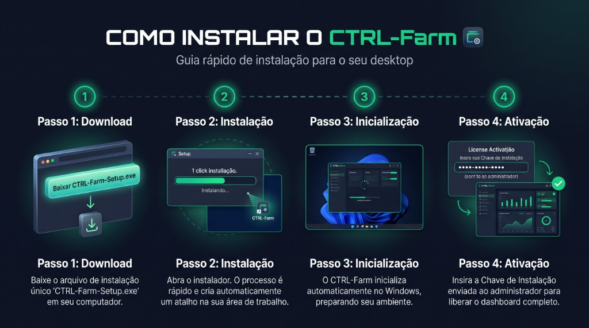

# Guia de Instalação e Ativação do CTRL-Farm 🖨️

> 🌐 **Website Oficial & Manual Interativo Online:** [https://saulooliveirati.github.io/CTRL-Farm/](https://saulooliveirati.github.io/CTRL-Farm/)  
> 📥 **Página Direta de Download & Instruções:** [https://saulooliveirati.github.io/CTRL-Farm/instalacao.html](https://saulooliveirati.github.io/CTRL-Farm/instalacao.html)

Bem-vindo ao **CTRL-Farm**, a plataforma industrial de gestão e monitoramento para fazendas e oficinas de impressão 3D!

Este guia foi elaborado para que você instale e ative o sistema em seu computador com Windows de forma rápida, simples e com zero complicação.

---

---

## 💻 Requisitos do Sistema

### Para Windows:
- **Sistema Operacional:** Windows 10 ou Windows 11 (64-bit)
- **Memória RAM:** Mínimo de 4 GB RAM (recomendado 8 GB)
- **Espaço em Disco:** 500 MB livres
- **Navegador:** Microsoft Edge ou Google Chrome (motor Chromium de visualização em janela)

### Para macOS:
- **Sistema Operacional:** macOS 11 (Big Sur) ou superior (Ventura, Sonoma, Sequoia)
- **Processador:** Apple Silicon (M1, M2, M3, M4) ou Intel x86_64 (Universal)
- **Memória RAM:** Mínimo de 4 GB RAM (recomendado 8 GB)
- **Espaço em Disco:** 500 MB livres

*Não requer Docker nem configuração manual de banco de dados em nenhuma das plataformas.*

---

## 🚀 Download dos Instaladores Oficiais

Escolha o instalador correspondente ao seu sistema operacional:

- 🪟 **[Baixar para Windows (CTRL-Farm-Setup.exe)](https://github.com/saulooliveirati/CTRL-Farm/releases/latest/download/CTRL-Farm-Setup.exe)** — Instalador autocontido de 1 clique.
- 🍏 **[Baixar para macOS (CTRL-Farm.dmg)](https://github.com/saulooliveirati/CTRL-Farm/releases/latest/download/CTRL-Farm.dmg)** — Imagem de disco universal Apple (Apple Silicon & Intel).

---

## 🛠️ Passo a Passo de Instalação

### Instalação no Windows (.exe):
1. Baixe o arquivo **`CTRL-Farm-Setup.exe`**.
2. Dê um duplo clique no arquivo baixado na sua pasta de Downloads.
3. Se o Windows SmartScreen exibir aviso de aplicativo recente:
   - Clique em **"Mais informações"**.
   - Em seguida, clique em **"Executar assim mesmo"**.
4. O instalador cria automaticamente os atalhos na Área de Trabalho e no Menu Iniciar.
5. O aplicativo inicializa em janela nativa e conecta à fazenda.

### Instalação no macOS (.dmg):
1. Baixe o arquivo **`CTRL-Farm.dmg`**.
2. Dê um duplo clique na imagem de disco baixada para montá-la no Finder.
3. Arraste o ícone **CTRL-Farm** para a pasta **Applications** (Aplicativos).
4. Abra o **CTRL-Farm** pelo Launchpad ou Spotlight.
5. No primeiro acesso, se o Gatekeeper da Apple alertar sobre desenvolvedor identificado, basta ir em *Ajustes do Sistema > Privacidade e Segurança* e clicar em **"Abrir Mesmo Assim"**.

---

### Passo 3 — Inicialização Automática
1. Ao concluir a instalação (ou ao clicar duas vezes no ícone **CTRL-Farm** na Área de Trabalho), o aplicativo inicializará automaticamente no Windows.
2. Uma janela nativa, limpa e dedicada será aberta diretamente na porta local segura, sem barras de ferramentas do navegador e com o ícone de monitoramento presente na bandeja do sistema (próximo ao relógio).

---

### Passo 4 — Solicitação e Ativação da Licença
1. No primeiro acesso, o sistema apresentará a tela de boas-vindas e ativação com o seu **ID de Instalação / Chave da Máquina**.
2. **Copie esse código** exibido na tela e envie ao desenvolvedor/administrador.
3. O administrador irá aprovar o seu acesso no Sistema ADM e enviará a sua **Chave Criptográfica de Licença**.
4. Cole a chave recebida no campo correspondente e clique em **"Ativar Sistema"**.
5. O painel completo será imediatamente liberado, permitindo que você controle impressoras, filamentos, ordens de serviço, câmeras e finanças com máxima performance!

---

## 🛠️ Suporte e Dúvidas

Se tiver qualquer dúvida durante a instalação ou precisar de nova chave de ativação:
- Contate diretamente o administrador do sistema.
- Os logs de diagnóstico ficam disponíveis em `%LOCALAPPDATA%\CTRL-Farm\Logs`.
